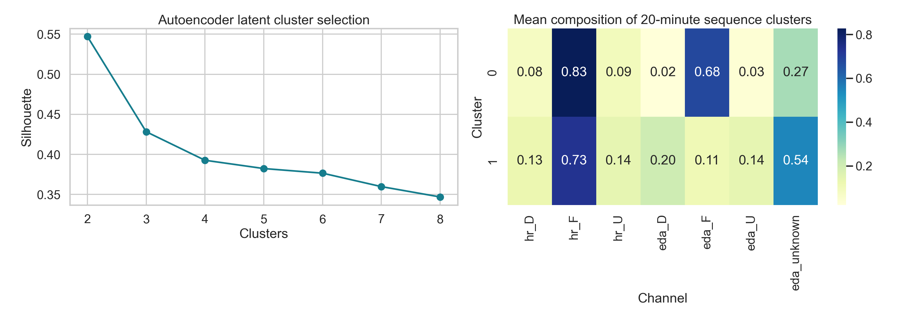

# Earlier HR/EDA pattern exploration

Selected results from exploratory work completed in August 2026. The report body, figure, and aggregate tables below come from existing local analysis outputs; the models were not retrained for this repository update. Coding and analysis implementation were extensively assisted by Codex.

The original analysis used higher-resolution recordings and intermediate direction labels. These inputs are not in the public minute-level CSV, so the original model fits cannot be reproduced from that CSV. The separate [public data overview](data-overview.md) can be reproduced directly.

## How to read these results

- U/F/D means rising/flat/falling **signal direction**, not a psychological state. "Confirmed EDA" is an algorithmic agreement rule: 60-second and 120-second direction estimates, confidence thresholds, and agreement with a neighboring minute. It is not external validation.
- The autoencoder used 20-minute sequences with a 5-minute stride, so windows overlap. Its encoder was fit on the first 70% chronologically, but clustering and selection of cluster count used all embeddings. The silhouette is descriptive, not held-out accuracy or evidence of generalization.
- Conditional probabilities and their intervals describe this selected, temporally dependent recording. They are not population estimates. The simple conditional-count model does not adjust its intervals for temporal dependence.
- The useful observation is that signal stability and unknown-EDA proportions explain much of the cluster separation. Activities and psychological states remain unlabeled.

## Existing report

### Data

- joined HR/EDA minutes: 40,960
- confirmed EDA minutes: 20,086 (49.0%)
- HR U/F/D comes directly from the prior composed HR pattern analysis.

### Autoencoder

- selected clusters: 2 (silhouette=0.547)
- clusters summarize 20-minute token compositions and are not physiological states.
- Cluster 0 is mostly HR-flat/EDA-flat with lower EDA uncertainty; cluster 1 contains more EDA-unknown and directional minutes.
- The autoencoder therefore separates signal availability/stability more strongly than a new physiological sequence pattern.

### Bayesian coupling

- P(EDA D | HR D)=0.317, 90% CrI [0.301, 0.332], n=788.
- P(EDA F | HR D)=0.291, 90% CrI [0.276, 0.306], n=724.
- P(EDA U | HR D)=0.392, 90% CrI [0.376, 0.408], n=976.
- P(EDA D | HR F)=0.246, 90% CrI [0.240, 0.252], n=3,652.
- P(EDA F | HR F)=0.539, 90% CrI [0.532, 0.545], n=7,995.
- P(EDA U | HR F)=0.215, 90% CrI [0.210, 0.221], n=3,195.
- P(EDA D | HR U)=0.384, 90% CrI [0.369, 0.399], n=1,059.
- P(EDA F | HR U)=0.299, 90% CrI [0.284, 0.313], n=823.
- P(EDA U | HR U)=0.317, 90% CrI [0.303, 0.332], n=874.

### Time series

- largest absolute lag association: lag=-1 min, r=-0.055, 90% CrI [-0.075, -0.035].
- Positive lag means HR direction leads EDA direction under this alignment.

### Markov structure

- FF->FF posterior mean is 0.933; FD->FD is 0.833; FU->FU is 0.783.
- These strong flat-HR persistence values partly follow from the confirmed-EDA selection rule and SDK smoothing.

### Limits

Confirmed EDA rules improve directional stability but preferentially retain long, smooth trends.
Markov persistence partly reflects SDK smoothing and skin conductance dynamics.
Autoencoder clusters and lag associations are descriptive; activities, movement, temperature, and sleep are uncontrolled.
Do not map joint tokens directly to stress, sympathetic tone, focus, recovery, or task cost.

## Published aggregate outputs

These small tables contain summary counts or model results, with no per-minute timestamps, session/device IDs, or raw recordings.

- [HR/EDA conditional probabilities](aggregate-results/bayesian_hr_eda_coupling.csv)
- [Joint transition probabilities](aggregate-results/bayesian_joint_markov.csv)
- [Lag associations](aggregate-results/bayesian_lag_association.csv)
- [Cluster profiles](aggregate-results/autoencoder_cluster_profiles.csv)
- [Cluster-count comparison](aggregate-results/autoencoder_k_scores.csv)
